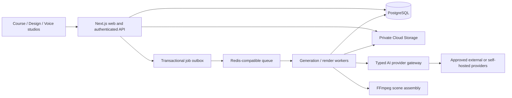

# Proposed architecture

## Boundaries

- `apps/web`: Next.js UI, authenticated API, ownership checks and signed asset access.
- `packages/domain`: course structure, validation, slide document and versioning rules; no provider SDK coupling.
- `packages/db`: migrations, transactional persistence, tenant-scoped repositories.
- `packages/ai`: capability registry, provider adapters, normalized errors, usage accounting.
- `apps/worker`: job claims, heartbeats, cancellation, artifact production and retries.
- `packages/contracts`: request/response schemas and shared TypeScript types.
- `infra`: deployment templates after cloud project and cost decisions are supplied.

This layout is proposed, not created as an empty pretend implementation. UI and API remain one deployment initially; workers share contracts and releases but have distinct runtime limits and service identities.

## Durable state and autosave

Course content is structured as projects → courses → modules → lessons. Presentations contain ordered slides with a versioned JSON object model; assets are immutable blobs with provenance. Updating a presentation requires its current revision. A transaction checks the revision, stores an immutable version snapshot, increments the revision and writes an audit event. A stale client receives 409 and must resolve conflicts; silent last-write-wins is not acceptable. Autosave is debounced with explicit Saving/Saved/Failed UI and recovery of local pending changes.

## Job lifecycle

`queued → running → succeeded | failed | cancelled`. A job creation transaction reserves estimated spend and writes an outbox entry. A dispatcher enqueues committed entries; reconciliation recovers after restarts. A database idempotency key scoped to tenant and operation prevents duplicate job submissions. Worker attempts acquire a lease and update heartbeats. Outputs are uploaded under temporary keys and finalized only after validation and a successful state transition. Retries use bounded exponential backoff for transient errors; permanent authentication, policy and validation failures do not loop. Cancellation is cooperative and external-provider cancellation is best effort; billed work may already have occurred.

## Media pipeline

Script → approved voice request → source audio → clip timeline → caption alignment → scene frames → FFmpeg mux → duration/decoding checks → artifact. Rendering is never performed inside an ordinary web request. A separate worker pool can process the same timeline specification using FFmpeg first or Remotion after license approval. Do not treat browser speech synthesis as exportable narration or a production TTS provider.

## Deployment boundary

Cloud Run hosts the stateless web/API. Worker hosting remains a deployment decision: continuously polling BullMQ needs continuously available compute/CPU and a reachable queue, while Cloud Run Jobs are finite tasks that need an explicit launcher. Do not deploy a request-scaled worker assuming it will keep polling after requests end. For a low-volume pilot, evaluate Cloud Tasks/Pub/Sub plus Cloud Run Jobs against BullMQ's fixed infrastructure cost before provisioning managed Redis.
